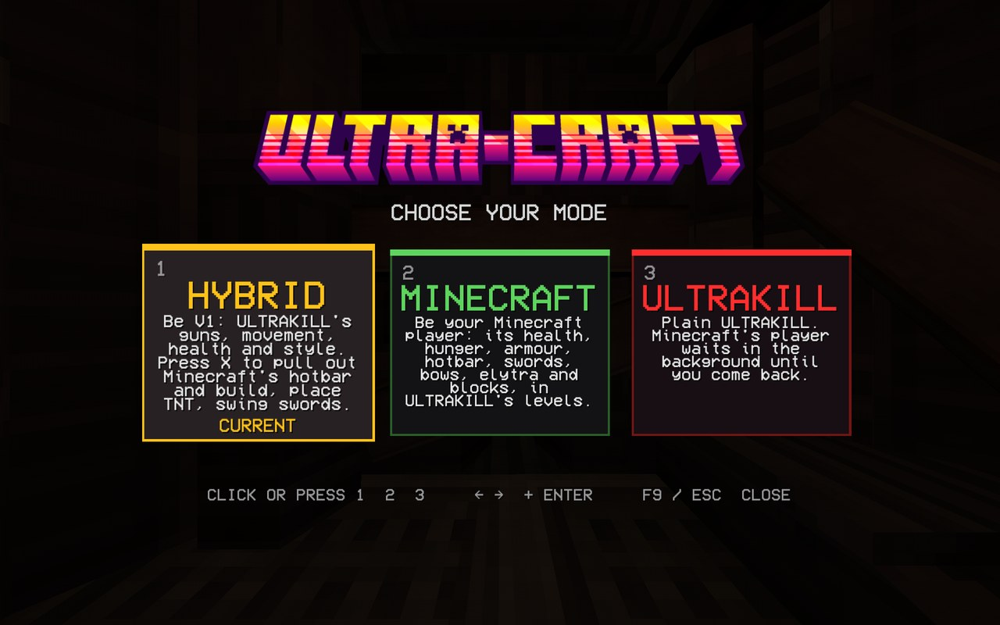
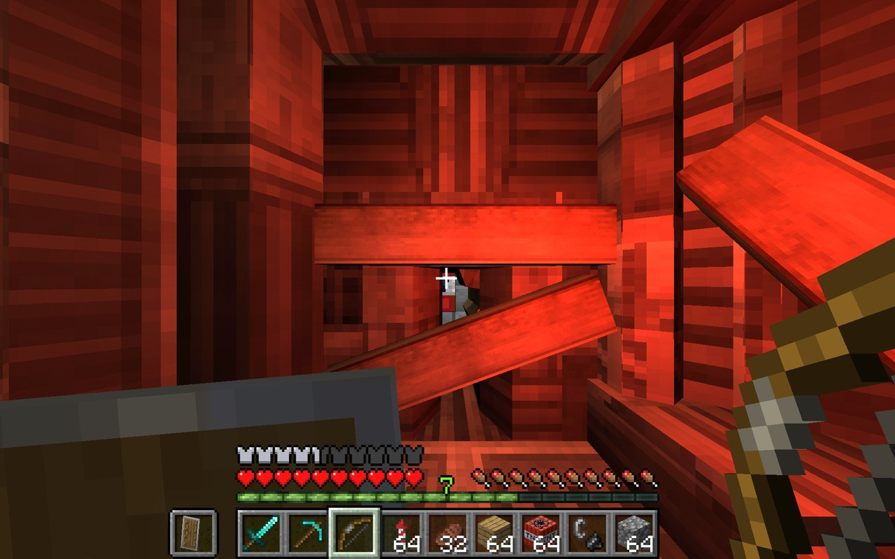
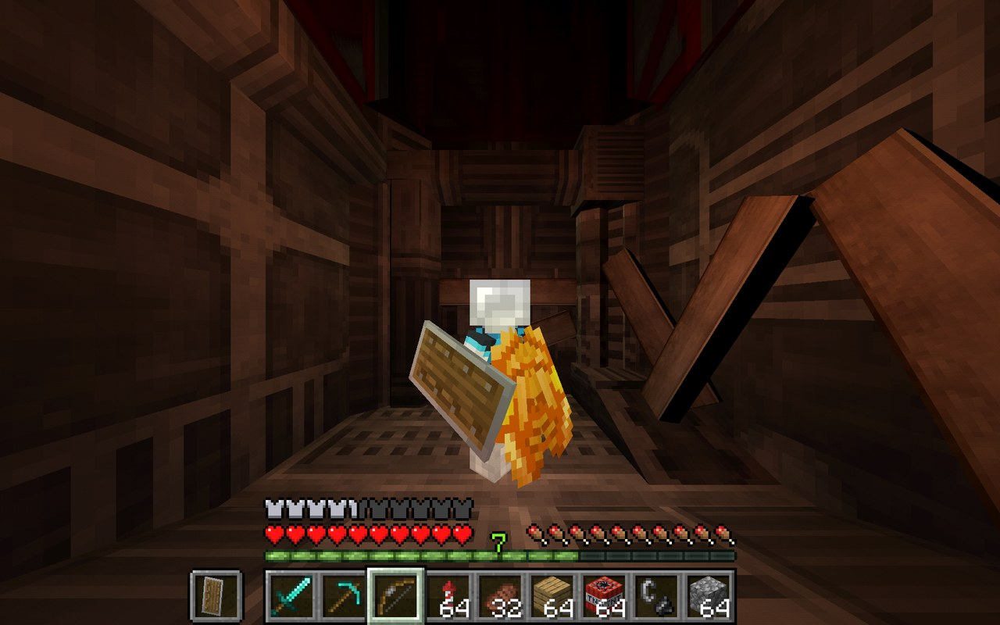
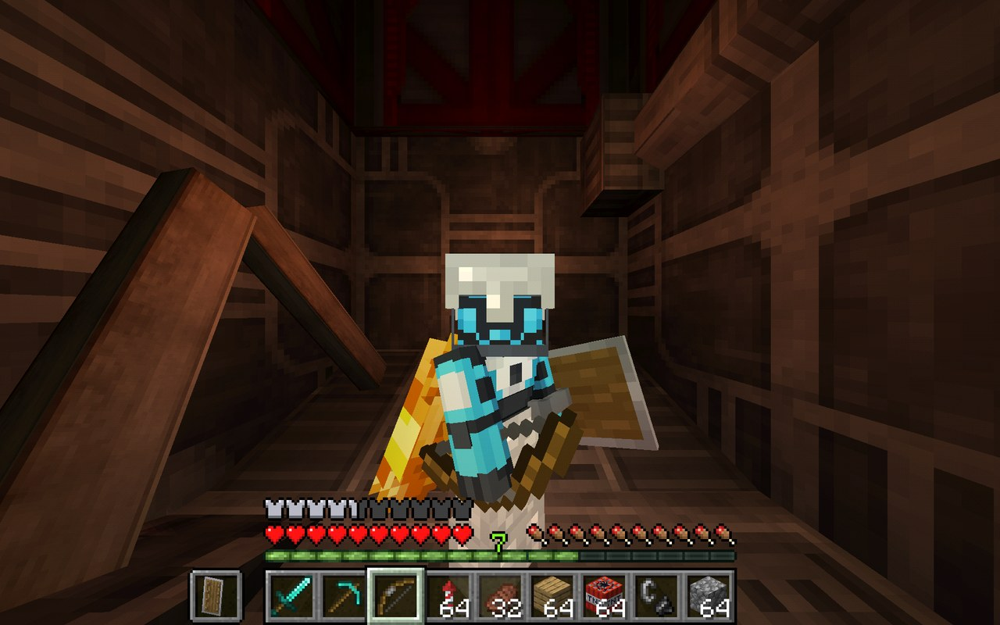

<p align="center"></p>

<p align="center"><b>Minecraft inside ULTRAKILL.</b><br/>
Dash, slide and shoot as V1, then pull out a Minecraft hotbar and build. Or become your Minecraft player in ULTRAKILL's levels, with Minecraft's health, swords, bows, elytra and TNT.</p>

<p align="center">
<a href="../../releases/latest"><b>Download the latest release</b></a> &nbsp;·&nbsp;
fork of <a href="https://github.com/goonsn/Killcraft">Killcraft</a> by goonsn &nbsp;·&nbsp;
built on <a href="https://github.com/chasmlol/SkyCraft">SkyCraft</a> by chasmlol &nbsp;·&nbsp;
<a href="LICENSE">MIT</a>
</p>

A real Minecraft runs hidden in the background (SkyCraft's mod plus Killcraft's Minecraft mod), and ULTRAKILL shows Minecraft's player, hand, HUD, blocks, mobs and items in its own world.

<table>
<tr>
<td></td>
<td></td>
</tr>
<tr>
<td align="center"><b>F9:</b> the mode menu</td>
<td align="center"><b>Minecraft mode</b> in ULTRAKILL's 0-1</td>
</tr>
<tr>
<td></td>
<td></td>
</tr>
<tr>
<td align="center"><b>F5:</b> third person, elytra on</td>
<td align="center">Your own Minecraft skin, lit by ULTRAKILL</td>
</tr>
</table>

## What ULTRA-CRAFT adds to Killcraft

- **Hybrid mode (the default):** you are V1, with ULTRAKILL's guns, arms, movement, health and style meter. **X** puts the guns away and takes out Minecraft's hand and hotbar: place and break blocks, light TNT, throw ender pearls, swing swords and shoot bows, while you still dash, slide and wall-jump like V1. **X** again brings the guns back. Blocks go where ULTRAKILL's crosshair is.
- **The mode menu:** **F9** opens it (the game pauses), with three modes to pick from by clicking, pressing 1-3, or the arrows and Enter.
- **ULTRAKILL's lighting on Minecraft:** your Minecraft hand and the item in it, your player in third person, mobs and dropped items are lit by ULTRAKILL's lights like V1's arm is. Red rooms tint them red, dark corners darken them, and muzzle flashes and explosions light them up. Minecraft's hotbar and hearts stay as they are.
- **Clean deaths in Minecraft mode:** dying shows a Minecraft death screen ("You Died!", your style score as the score, **Respawn**) over the paused game. **Respawn** puts you back at ULTRAKILL's last checkpoint, with no ULTRAKILL death screen flickering in between, and picking Minecraft mode in mid-air no longer drops you to your death.
- **Style points for Minecraft kills:** **+MINECRAFTED**, **+ARROWED**, **+SWEPT**, **+SMELTED**, **+THORNED** and **+CRITICAL HIT** on ULTRAKILL's style meter.
- **Your own key binds:** **O** opens Minecraft's menu in Minecraft and Hybrid mode (Options, Controls, Key Binds). In Hybrid, the keys that stay ULTRAKILL's while you build are the ones ULTRAKILL's own options have for moving, jumping, dashing and sliding.
- **Elytra:** the starting kit has an elytra on, rockets in the hotbar and the iron chestplate in the inventory. While you fly fast, the level's walls ahead of you are sent to Minecraft first, so you don't fly through them.
- **Fixed:** following V1 from far away (a new level, a far checkpoint) no longer makes one huge jump that freezes Minecraft's server.

## The modes

| Mode | You are | Minecraft |
|---|---|---|
| **Hybrid** (default) | V1: ULTRAKILL's guns, movement, health and style | **X** lends your hands to Minecraft: its hotbar, blocks, TNT, swords and bows. Its mobs fight on your side and its sound stays on |
| **Minecraft** | Your Minecraft player: Minecraft's movement, health, hunger, armour and inventory | Has V1. **F5** is third person |
| **ULTRAKILL** | Plain V1 | Waits in the background, following you around |

## Everything from Killcraft

- Minecraft movement and physics on ULTRAKILL's level geometry (walls, floors, slopes, doors).
- Minecraft's HUD (hotbar, hearts, hunger, armour, held items), with ULTRAKILL's HUD hidden.
- Fighting: swords, crits, sweeps, bows, tridents and TNT hurt ULTRAKILL's enemies through ULTRAKILL's own damage system.
- Getting hurt: enemy hits go to Minecraft's health, so armour, Protection enchantments, golden apples and shields all work (raise the shield towards the enemy).
- Blocks you place show up in ULTRAKILL with Minecraft's textures, block enemies and their shots, and light the level (torches, lanterns).
- Arrows stick in walls, doors (and move with them) and enemies, stay in their corpses, and can be picked up again from corpses and the floor. Dropped items lie on the floor, and lit TNT flashes and explodes with an ULTRAKILL explosion.
- Minecraft mobs fight on your side: spawn zombies, skeletons, iron golems, wolves, creepers, ... with spawn eggs and they go after ULTRAKILL's enemies near them. In the levels they leave you alone.
- **The Nether:** build a Nether portal anywhere in a level (`/give @s minecraft:obsidian 14`, then flint and steel) and stand in it for 3 seconds. You go to Minecraft's real Nether, with its own part for every level, and its mobs attack you there, along with ULTRAKILL enemies that keep turning up around you (filth, strays, drones, schisms, soldiers, streetcleaners) and climb its blocks after you. Now and then a mini-boss turns up too, with a boss bar (a swordsmachine, cerberus, guttertank, gutterman, mindflayer, hideous mass or ferryman). ULTRAKILL shows it around V1, with Minecraft's Nether fog. Any Nether portal brings you back to the portal you came through, and dying there respawns you in the level.
- **ULTRAKILL's weapons tear up the Nether:** explosions blow holes in it (a rocket shot out of the air with the revolver is a big one, and sets fires), charged revolver shots and the railcannon bore tunnels, and the red shotgun's chainsaw mines through blocks (they drop).
- **ULTRAKILL mode works everywhere, the Nether included:** Minecraft's player comes along with V1 (through Nether portals too), what would hurt it (mobs, lava, fire) hurts V1 instead, and ULTRAKILL's weapons (beams, pellets, nails, saws, explosions, punches, the chainsaw) hurt Minecraft's mobs, which drop their loot. Minecraft's sound is off meanwhile.
- **Potion of ULTRAKILL** (Killcraft's Minecraft mod): drink it and you move like V1 (dash, slide, wall jumps, ULTRAKILL's speed) for two minutes, while keeping Minecraft's hotbar, items and health. Craft it from a glass bottle, sugar, a feather and redstone, find it in the creative menu's Killcraft tab, or `/give @s killcraft:ultrakill_potion`.
- **SMILEOS shops as blocks** (Killcraft's Minecraft mod): place a SMILEOS Shop (iron ingots around a glass pane with redstone below, or `/give @s killcraft:smileos_terminal`) and ULTRAKILL's real shop stands there, to buy and change weapons anywhere.
- **ULTRAKILL's skulls in your inventory:** picked-up skulls go into Minecraft's hotbar (blue, red and green, carry as many as you like) and the one you select is in your hand, to put in its altar.
- Third person with F5 (behind and in front, as in Minecraft), with the camera stopping at walls and Minecraft's player shown.
- Your Discord status shows that you play ULTRAKILL as a Minecraft player (Killcraft's Discord app).
- Bosses hit harder the higher ULTRAKILL's difficulty, and go through armour (see the settings).
- Jump pads launch you (the Cybergrind's too), and crouching stops you at edges, so you can bridge.
- Shields block ULTRAKILL's attacks, thorns armour hurts ULTRAKILL's enemies, and a swing parries projectiles (Stray energy balls, ...) like V1's punch, and parrying the same one again and again sends it back harder each time.
- SMILEOS terminals and shops can be clicked.
- Potion effects work on the Minecraft player (speed, jump boost, strength, resistance, regeneration, ...).
- Dying in Minecraft mode shows a Minecraft death screen, and **Respawn** brings you back at ULTRAKILL's last checkpoint. Dying as V1 is ULTRAKILL's own death.
- Every ULTRAKILL level gets its own place in the Minecraft world.

## What you need

- **ULTRAKILL** (Steam).
- **BepInEx 5** for ULTRAKILL: [BepInEx 5 releases](https://github.com/BepInEx/BepInEx/releases) (`BepInEx_win_x64_5.4.x.zip`), unzipped into the ULTRAKILL folder. Start the game once so BepInEx sets itself up.
- **Minecraft Java Edition** (a Microsoft account that owns it).

You don't need SkyCraft or Skyrim: the download already has SkyCraft's Minecraft bundle in it (`SkyCraft-Minecraft.zip`, a portable Prism Launcher with the SkyCraft Minecraft instance). Minecraft and Java download by themselves the first time.

## Install

1. Download `UltraCraft-<version>.zip` from this page's **Releases** and unzip it into `ULTRAKILL\BepInEx\plugins\`, so you have `ULTRAKILL\BepInEx\plugins\UltraCraft\UltraCraft.dll`. Leave `SkyCraft-Minecraft.zip` in that folder zipped.
2. Start ULTRAKILL. ULTRA-CRAFT unpacks and starts Minecraft by itself (hidden). **The first time**, Prism Launcher asks you to sign in to your Microsoft account, and Minecraft and Java download (a few minutes).
3. Start any level. You start in Hybrid mode: press **X** to build, **F9** for the mode menu.

To update, unzip the new version over the old one. **Coming from Killcraft?** ULTRA-CRAFT replaces it by itself (it's a newer version of the same BepInEx plugin, so BepInEx skips Killcraft.dll) and keeps your settings. You can delete the old `Killcraft` folder.

**Tip:** to keep Steam's ULTRAKILL unmodded, copy the whole ULTRAKILL folder somewhere else (for example `D:\Games\ULTRAKILL UltraCraft`) and install BepInEx and ULTRA-CRAFT into the copy. The copy starts from its own `ULTRAKILL.exe` (keep Steam open) and has its own saves.

## Controls

Minecraft's own controls (WASD, space, shift, mouse buttons, 1-9, E for the inventory, Q to drop, ...), plus:

| Key | |
|---|---|
| **F9** | The mode menu: Hybrid, Minecraft or ULTRAKILL (if it does nothing, check your keyboard's Fn lock, or pick another key with `ToggleMinecraft`) |
| **X** | Hybrid: Minecraft's hotbar out (guns away), and back (`BuildKey`) |
| **F5** | Third person (behind you, then in front, then back to first person) |
| **O** | Minecraft's menu (options, ...) |
| **Esc** | ULTRAKILL's pause menu, which pauses Minecraft too and mutes its sound (or closes an open Minecraft screen) |

## Settings

`ULTRAKILL\BepInEx\config\dev.killcraft.cfg` (made on the first start; the name is Killcraft's, so Killcraft's settings carry over):

| Setting | Default | |
|---|---|---|
| `ToggleMinecraft` | `F9` | The key that opens the mode menu |
| `StartMode` | `Hybrid` | The mode a session starts in: `Hybrid`, `Minecraft` or `Ultrakill` |
| `BuildKey` | `X` | Hybrid: Minecraft's hotbar out, and back |
| `MinecraftMenuKey` | `O` | Opens Minecraft's menu (options, key binds) |
| `MinecraftStyle` | `true` | Style meter bonuses for Minecraft kills |
| `FreshWorldEachLaunch` | `true` | Every session starts with a fresh Minecraft world and the starting kit. `false` keeps your builds and inventory between sessions |
| `MobsFightEnemies` | `true` | Minecraft mobs go after ULTRAKILL's enemies near them |
| `MobsAttackYouInLevels` | `false` | Minecraft mobs attack you in ULTRAKILL's levels too (off: they're on your side there; in the Nether they always attack you) |
| `NetherEnemies` | `6` | How many ULTRAKILL enemies are around you at a time in the Nether (0: none) |
| `NetherMiniBosses` | `true` | Now and then a mini-boss turns up in the Nether, one at a time |
| `AlwaysThorns` | `true` | Thorns armour hits back every time an enemy hurts you (Minecraft's own: 15% a level) |
| `TntFuseTicks` | `40` | How long lit TNT burns (20 = one second; Minecraft's own is 80) |
| `DigIntoLevels` | `false` | Let TNT and pickaxes dig into ULTRAKILL's level geometry (the holes don't show in ULTRAKILL) |
| `DamageToUltrakill` | `0.3` | ULTRAKILL damage per point of Minecraft damage you deal |
| `DamageToMinecraft` | `1.0` | Multiplier on the damage enemies do to you |
| `DamageByDifficulty` | `true` | Enemies hit harder on harder difficulties (Harmless x0.5 up to UKMD x2.5) |
| `BossDamage` | `1.5` | Extra multiplier on the damage bosses (V2, Gabriel, the Primes, ...) do to you |
| `BossesPierceArmour` | `true` | Bosses' hits go through armour (Protection enchantments still count, a raised shield still blocks) |
| `BlockBrightness` | `1.0` | How bright Minecraft blocks are drawn (lower it in dark levels) |
| `UltrakillLightOnMinecraft` | `true` | ULTRAKILL's lights shine on Minecraft's hand, held item, player, mobs and dropped items |
| `Darkest` | `0.35` | How dark those get with no ULTRAKILL light on them (0 black, 1 never darker) |
| `Strength` | `1.0` | How strongly ULTRAKILL's light counts (higher: full brightness under dimmer lights) |
| `UnitsPerBlock` | `2` | ULTRAKILL units per Minecraft block (2 makes the Minecraft player about V1's height) |
| `StartWithUltrakill` | `true` | Start Minecraft when ULTRAKILL starts |
| `ApplicationId` | (empty) | Your Discord status: empty shows Killcraft's ("Playing ULTRAKILL as a Minecraft player"), `skycraft` SkyCraft's own, `0` none |

## Known limits

- In Minecraft mode, ULTRAKILL's own weapons, movement tech and style meter aren't used (Hybrid has them).
- In Minecraft mode, Minecraft's fall damage counts: ULTRAKILL's big drops can kill you (an elytra helps).
- Blocks don't get ULTRAKILL's baked level lighting, so they can look bright in dark levels (see `BlockBrightness`).
- Minecraft mobs and particles other than TNT, falling blocks and explosions are only partly shown.
- ULTRAKILL's enemies only ever attack V1, not Minecraft mobs.
- The level's own enemies wait in the level and ignore you while you're in the Nether. You always arrive at height 70, in a small room dug out for the portal.
- ULTRAKILL's weapons only break blocks in the Nether (in the levels, Minecraft's blocks are your own builds).
- Holding right click (a raised shield, a drawn bow, eating) stops left clicks attacking, as in Minecraft.
- Mobs on your side in the levels don't fight back when you hit them, and don't fight each other (an iron golem leaves zombies alone).
- Flint and steel and fire charges light ULTRAKILL's floors only from the side: aim at the bottom of a wall just above the floor, or at the side of a step (aiming straight down at a floor doesn't work). Minecraft blocks light as usual (netherrack burns forever). Enemies walking through fire or lava burn.
- Minecraft only has the level's collision about 36 blocks around you: an ender pearl thrown further comes back to you.
- Effects that only change how Minecraft looks (night vision, blindness, darkness, nausea, invisibility) don't show in ULTRAKILL, and invisibility doesn't hide you from its enemies.
- Zombies, skeletons and other mobs that burn in daylight don't catch fire at all (ULTRAKILL's levels are in Minecraft daylight).
- Minecraft can't plan mob paths over ULTRAKILL's levels, so ULTRA-CRAFT walks fighting mobs straight at their enemy: they can't find their way around walls or up to other floors. The warden, piglins, hoglins and breezes aren't walked (only set on the enemy).
- Items held by mobs (a skeleton's bow) can show white.

## Building from source

Needs the .NET SDK (6 or newer) and ULTRAKILL with BepInEx installed.

```
dotnet build -c Release
```

If ULTRAKILL isn't in `C:\Program Files (x86)\Steam\steamapps\common\ULTRAKILL`, add `-p:GameDir="X:\path\to\ULTRAKILL"`. The build copies `UltraCraft.dll` into `BepInEx\plugins\UltraCraft\`.

Killcraft's Minecraft mod (`mcmod/`, Fabric for Minecraft 26.3) needs Java 25 and SkyCraft's mod jar in `mcmod/libs/` (`skycraft-0.1.2.jar`, from SkyCraft's Minecraft bundle):

```
cd mcmod
gradlew build
```

The build copies `mcmod/build/libs/killcraft-mc-*.jar` next to `UltraCraft.dll` as `killcraft-mc.jar`, and ULTRA-CRAFT puts it into Minecraft's mods folder when it starts.

The code (its namespace is still `Killcraft`): `ModeMenu.cs` is the F9 menu, `UkLighting.cs` lights Minecraft's things with ULTRAKILL's lights, `Link.cs`/`Proto.cs` speak SkyCraft's shared-memory protocol, `Host.cs` hands V1 to Minecraft and back, `Collision.cs` streams ULTRAKILL's level geometry to Minecraft, `Combat.cs` mirrors enemies and applies hits, `WorldRender.cs` draws Minecraft's blocks, items and entities, `Overlay.cs` shows Minecraft's HUD, `InputForward.cs` sends the keyboard and mouse to Minecraft, `Nether.cs` makes ULTRAKILL look like the Nether while you're there, `NetherWorld.cs` gives the Nether's terrain collision, a navmesh and ULTRAKILL enemies, `McAudio.cs` mutes Minecraft while paused, `McSave.cs` prepares Minecraft's world (and writes Killcraft's data pack) before it starts, `HeldItems.cs` puts ULTRAKILL's skulls in Minecraft's inventory, `SmileOs.cs` stands ULTRAKILL's shop on SMILEOS blocks, `Destruction.cs` and `MobHits.cs` take ULTRAKILL's weapons to Minecraft's blocks and mobs, and `mcmod/` is Killcraft's Minecraft mod (the potion, the SMILEOS block, the skulls, and Minecraft's side of all that).

## Credits

- **ULTRA-CRAFT** by [ReimaginedPixel](https://github.com/ReimaginedPixel): Hybrid mode, the mode menu, ULTRAKILL lighting on Minecraft, Minecraft-mode deaths, style bonuses, key binds and the elytra kit.
- [Killcraft](https://github.com/goonsn/Killcraft) by goonsn (MIT): ULTRA-CRAFT is a fork of it. Everything else ULTRAKILL-side (Minecraft mode, collision, combat, the Nether, the Minecraft mod in `mcmod/`) is Killcraft's.
- [alfr0762](https://github.com/alfr0762): the idea of SMILEOS terminals as Minecraft blocks.
- [SkyCraft](https://github.com/chasmlol/SkyCraft) by chasmlol (MIT): the Minecraft mod, the link protocol and the idea. Killcraft is the ULTRAKILL side of it. The release zip includes SkyCraft's unmodified `SkyCraft-Minecraft.zip` with its license (`SkyCraft-LICENSE.txt`) and third-party notices (`SkyCraft-THIRD-PARTY-NOTICES.md`).
- ULTRAKILL by Arsi "Hakita" Patala / New Blood Interactive. Minecraft by Mojang Studios. ULTRA-CRAFT and Killcraft aren't affiliated with either and contain none of their files.

## License

[MIT](LICENSE)
